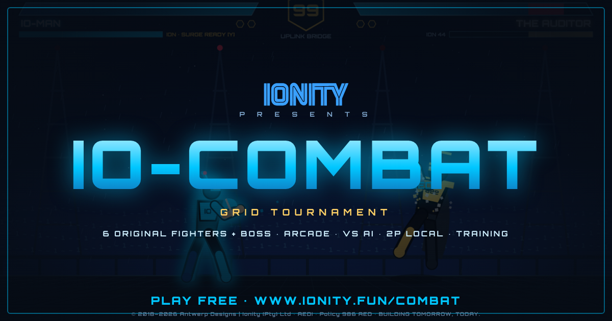

# IONITY IO-COMBAT — GRID TOURNAMENT

> An original 2D arcade fighter in a single HTML file. Pick an avatar, win two rounds, then **TERMINATE** your rival before the clock runs out.

**Document ID:** GME-2026-10-011 · **Version:** 1.2.0 · **Classification:** PUBLIC (source published for reference)
**Author:** Johan Wilhelm van Antwerp · Ionity (Pty) Ltd · AEDI (Antwerp Ecosystems Designs Ionity) · ORCID [0009-0005-7181-0347](https://orcid.org/0009-0005-7181-0347)
**Governance:** Policy 986 AED · **License:** AED 900 · CC BY-NC-SA 4.0 where stated
**Play:** https://www.ionity.fun/combat/ · **Web:** https://www.ionity.today · https://www.ionity.world · Ref: https://www.ionity.co.za · Contact: ai@ionity.today
**Sister game:** [IO-MAN — Get Over It Door](https://www.ionity.fun) (GME-2026-09-002)



---

## v1.2.0 — "ONLINE PvP & CONTROLS BAR": what's new

**⚡ Online PvP through the IONITY CLOUD queue.** Pick *Online PvP · Ranked Queue* on the title, choose your avatar and tag, then press **FIND MATCH**.

How a match comes together:
1. **Sign-in.** Each tab signs in anonymously to Firebase (project `io-man`, the same Spark-tier backend as IO-MAN). There is no account and no personal data.
2. **Queue.** You join a **Firestore matchmaking queue**, `pvp_queue`, with a heartbeat every 8 s. Whoever finds a waiting player first claims them in a transaction. If two players queue at the same moment, a uid tie-break makes sure only one of them claims.
3. **Room.** The claimer opens a `pvp_rooms/{id}` signalling room. The two browsers swap the WebRTC offer, answer and ICE candidates there.
4. **Peer-to-peer link.** From then on all gameplay runs **directly between the two browsers** over a WebRTC data channel. Firestore is only used for the queue and the handshake, about 20 writes per match, so the free tier comfortably covers it. The signalling documents are deleted once the link is up.

How the match stays in sync:
- **Lockstep netcode.** Both browsers run the same deterministic 60 Hz simulation from the same inputs. The input delay (2–8 frames) is set from a 6-ping RTT measurement taken before the match.
- **Desync safety net.** Both sides hash the game state every 30 frames. On a mismatch the host sends a full snapshot and the guest re-simulates from it.
- **HUD:** shows YOU / RIVAL tags and live ping and delay, plus a "WAITING FOR RIVAL" notice if the link stalls.
- **After the match:** **REMATCH** needs both players to accept. Leaving, or a 12-second stall, gives the remaining player a **forfeit win**.
- **Records:** online wins and losses are kept on the device.

**Network notes.** Connections use public STUN only (Google, Cloudflare). On a few strict corporate or carrier NATs a direct link may not be possible, and the game says so after 20 s. Playing on ionity.fun is recommended.

**Security rules.** The Firestore rules for the PvP collections went live on `io-man`, alongside the existing IO-MAN rules, and the file is in `IO-Man/firebase/firestore.rules`. The rules check:
- the shape of queue entries and the clean-tag filter;
- that a claim may only flip `status → matched` and attach the claimer;
- that rooms are readable and writable only by their two members;
- that ICE candidates are readable only inside their room.

**Controls bar below the arena** (Options → *Controls bar*: AUTO / ON / OFF; AUTO means on for desktop, off for touch):
- **Layout:** live keycaps for every action sit under the game. The arena shrinks slightly so the bar never covers it.
- **Feedback:** keys **light up as you press them**, combos like `S+F` light up when both are held, and ION costs dim until you can afford them. **SURGE pulses gold** when ready, and the SIG cap shows your fighter's signature name.
- **By mode:** 2P shows a P1 group and a P2 group side by side. Menus show navigation hints.

**Minor polish**
- **FIRST STRIKE:** the first clean hit of each round gives +5 ION.
- **10 SECONDS:** a warning appears as the round clock runs out.
- **Typing:** the name box no longer triggers game keys.

## v1.1.0 — "FULL SCREEN & SIGNATURES": what's new

**Fullscreen-first.** The game now fills the whole browser window, letterboxed to 16:9, with no page header or footer.
- **Real fullscreen** turns on automatically with your first tap or key (splash, menu or ENGAGE). Fullscreen also locks landscape on phones that allow it.
- **Toggles:** the floating **⛶ Full** button top-right, or **double-click** the arena. **Options → Auto fullscreen** turns the automatic switch off.
- **Toolbar:** Menu · Moves · Options · Sound · Full floats over the arena and **fades out during fights**. It comes back when you move the mouse.
- **Installable app (PWA):** a manifest with `display: fullscreen`, landscape orientation, icons and a service worker for offline play. *Add to Home Screen* launches it fullscreen like a native game.

**Signature moves** (`S`+`R` / `▼`+BLAST, 25 ION), one per fighter:

| Fighter | Signature | What it does |
|---|---|---|
| IO-MAN | **AXE CYCLONE** | rising spin with an invulnerable start; a true anti-air that launches |
| VOLTA | **THUNDER DROP** | leaps over the rival and dives: overhead on the way down, low shockwave on landing |
| CRYO-CORE | **GLACIER WALL** | ice wall that destroys 3 enemy projectiles and freezes anyone who touches it |
| NULL | **VOID SWAP** | swaps sides with the rival and leaves them disoriented |
| MYCELIA | **SPORE TRAP** | hidden mine that launches and poisons; one at a time |
| BLAZE-443 | **FLAME PILLAR** | marks the rival's spot and erupts half a second later |
| THE AUDITOR | **ASSET SEIZURE** | long-range command grab that steals up to 35 ION |

**New defence and comeback mechanics**
- **PERFECT GUARD:** tap block within 6 frames of a hit. You take no damage and gain +15 ION, and a melee attacker is staggered so you can punish.
- **ION BREAKER:** block + kick while being hit (50 ION). Invulnerable burst that knocks the rival away and resets their combo.
- **OVERCLOCK:** below 25% health your hits deal +12% damage, with a red aura and HUD tag.

**New mode: SURVIVAL.**
- One round per challenger, against endless random rivals. THE AUDITOR shows up every 6th fight once you reach 5 wins.
- Your health carries over, plus 25 per win. The CPU gets harder every 4 wins.
- Your best run is saved on the device.

**Presentation**
- **Dynamic camera:** zooms in up to 1.18× as the fighters close in, and harder on SURGE and finishers. It can be turned off in Options.
- **Announcer voice:** the browser's built-in speech says "Round 1", "Engage", "Terminate", "Deleted" and "… wins". It can be turned off in Options.
- **Impact effects:** shockwave rings on heavy hits, surges, breakers and parries.
- **Alternate colours:** `G` (P1) / `K` (P2) or the 🎨 button on the select screen. In a **mirror match**, P2 switches to the alternate colours automatically.
- **Rival banter:** each rival's taunt shows on the ladder screen, and the winner's quote on the results screen.

**AI.** The CPU now uses every signature move in context: anti-air cyclones, walls against zoners, swaps out of the corner and seizures against blockers. It also uses the ION BREAKER when caught in long combos, and on IRON it naturally perfect-guards.

**Fixes.** An attack that was parried could crash the update loop. The attacker's state is now guarded.

## Play

Open `index.html` (identical to `IONITY_IO-COMBAT.html`) in any modern browser, or play at https://www.ionity.fun/combat/. Nothing to install, and it works offline (only the display fonts come from Google Fonts, with fallbacks).
On phones, play in **landscape**. Portrait shows a rotate screen and pauses the game. Touch controls appear by themselves.

| Action | P1 keyboard | P2 keyboard (2P) | Gamepad | Touch |
|---|---|---|---|---|
| Move · dash | `A`/`D` · double-tap | `◀`/`▶` · double-tap | stick / d-pad | ◀ ▶ |
| Jump · crouch | `W` (or `Space`) · `S` | `▲` · `▼` | A / up · down | ▲ ▼ |
| Punch (3 in a row = **TRIPLE**) | `F` | `J` / Num1 | X | PUNCH |
| Kick | `G` | `K` / Num2 | Y | KICK |
| **SWEEP** (low, knocks down) | `S`+`F` | `▼`+`J` | down + X | ▼ + PUNCH |
| **UPLINK** launcher | `S`+`G` | `▼`+`K` | down + Y | ▼ + KICK |
| Jump-in punch / kick (overhead) | `F` / `G` in the air | `J` / `K` in the air | X / Y in the air | in the air |
| Block · low block | hold `H` · `S`+`H` | `L` / Num3 · `▼`+`L` | RB / RT | BLOCK |
| **DATA GRAB** (beats block) | `H`+`F` up close | `L`+`J` | RB + X | BLOCK + PUNCH |
| Element projectile (30 ION) | `R` | `U` / Num4 | B | BLAST |
| Blink strike: teleport behind (40 ION) | `T` | `I` / Num5 | LB | BLINK |
| **ION SURGE** super beam (100 ION) | `Y` | `O` / Num6 | LT | SURGE |
| **Signature move** (25 ION) | `S`+`R` | `▼`+`U` | down + B | ▼ + BLAST |
| **Perfect Guard** | tap `H` just before a hit | tap `L` | tap RB | tap BLOCK |
| **ION Breaker** (50 ION, while hit) | `H`+`G` | `L`+`K` | RB + Y | BLOCK + KICK |
| Alt colours (select screen) | `G` | `K` | | 🎨 |
| Fullscreen | ⛶ button / double-click | | | ⛶ |
| Pause · mute · music (online: menu, forfeit) | `P`/`Esc` · `M` · `N` | | Start | II |
| Training dummy mode | `Tab` | | | |

In 1P modes, the arrow keys and `J K L U I O` also control P1.

## Rules of the Grid

- **Matches:** best of 3 by default (Options: 1–3 rounds to win), with a 99-second timer (60, 99 or 150).
- **Blocking:**
  - A standing block stops highs, mids and jump-ins.
  - A **crouch block** stops sweeps but not jump-ins.
  - **Punches whiff over crouchers.**
  - **Grabs beat blocking.**
  - Specials and SURGE chip through blocks.
- **ION meter:** fills as you deal and take hits, plus a slow trickle over time. 30 buys a projectile, 40 a blink and 100 an **ION SURGE**. A SURGE is a cinematic freeze followed by a full-screen beam, and you can jump over it.
- **Finisher:** the KO that decides the match triggers **TERMINATE!** The loser is left dizzy, and you have 4 seconds to land a kick, UPLINK, special, blink or SURGE. That **DELETES** the rival (they derez into data cubes). If you're too slow, the rival is **SPARED**.
- **Combos:**
  - Hits within 70 frames chain into a combo. Damage scales down after 3 hits.
  - UPLINK launches the rival into a juggle, up to 4 hits.
  - Every third punch in a chain is a **TRIPLE**: ×1.6 damage and a knockdown.
- **Elements** (applied by projectiles and SURGE):

| Element | Fighter | Effect |
|---|---|---|
| ION | IO-MAN | big knockback ("IONISED") |
| VOLT | VOLTA | extra stun |
| CRYO | CRYO-CORE | freeze, about 1 s |
| VOID | NULL | drains 25 ION from the rival, gives you 10 |
| SPORE | MYCELIA | poison over time |
| FIRE | BLAZE-443 | burn over time |
| AUDIT | THE AUDITOR | the hardest-hitting beam, plus an ION fine |

Damage over time can never land the final KO.

## Roster (all original Ionity characters)

| Fighter | Title | Blast · Blink · Surge | Power / Speed / Defence |
|---|---|---|---|
| **IO-MAN** | Axe of Ions · Hero of the Grid (from *Get Over It Door*) | ION AXE · PACKET DASH · GET OVER IT | 90 / 90 / 88 |
| **VOLTA** | Edge Node Sentinel | EDGE ARC · SPARK HOP · GRID OVERLOAD | 84 / 98 / 80 |
| **CRYO-CORE** | Coolant Daemon of the Server Hall | COOLANT LANCE · FROST BLINK · ABSOLUTE IDLE | 86 / 84 / 96 |
| **NULL** | Void Pointer Assassin | SEGFAULT ORB · NULL BLINK · UNDEFINED | 88 / 94 / 82 |
| **MYCELIA** | Spore Witch of the Root | SPORE CLOUD · ROOT WALK · GREAT BLOOM | 85 / 88 / 90 |
| **BLAZE-443** | Firewall Gate Guardian | PORT BLAST · FLARE STEP · DENY ALL | 97 / 80 / 90 |
| **THE AUDITOR** (boss) | Governance Overlord | COMPLIANCE BEAM · SUBPOENA · FULL AUDIT | 100 / 86 / 100 |

The stats feed the formulas directly: damage scales with power ÷ defence, and walk and jump speeds scale with speed. THE AUDITOR is 10% larger. It is **locked until you clear Arcade once**.

## Modes

- **Online PvP:** Firestore matchmaking queue, peer-to-peer lockstep, rematch and forfeit.
- **Survival:** endless one-round fights. Health carries over (+25 per win), and the best run is saved.
- **Arcade Ladder:** five random rivals, then THE AUDITOR in the ROOT CAVERN. The CPU gets one step harder for the last two fights. A loss offers CONTINUE without losing ladder progress, and clearing the ladder unlocks the boss.
- **Versus AI:** you choose the rival, arena and CPU level: EASY / NORMAL / IRON.
- **2P Local:** two players on one keyboard, or two gamepads.
- **Training:** no timer, and health and ION refill. `Tab` cycles the dummy through STAND / BLOCK / LOW BLOCK / JUMP / CPU.

## Arenas

| Arena | Scenery |
|---|---|
| **SERVER CORE** | racks with live LEDs and the IONITY sign |
| **FIREWALL GATE** | burning brick firewall with embers |
| **DATA FOREST** | binary leaves and fireflies |
| **UPLINK BRIDGE** | antenna towers, a data sea and rain |
| **ROOT CAVERN** | the dormant fungus eye, glowing mushrooms and rising spores (the boss arena) |

## What's new vs. the prototype it was built from

IO-COMBAT started from a generic HTML5 fighting-game prototype. It was rebuilt and rebranded for Ionity: every franchise character, name, catchphrase and gore effect was replaced with original Ionity content.

**Engine**
- **Fixed 60 Hz simulation:** the game runs at the same speed on 60, 120 and 144 Hz screens. The prototype ran twice as fast on 120 Hz.
- **Unified input:** keyboard, gamepad, touch and AI all drive the same pad.
- **Input buffering:** a 6-frame buffer that also remembers whether down or block was held when the button was pressed.
- **Feel:** frame data for every move (startup, active, recovery), hit-stop, pose blending, afterimages, push boxes, wall handling and juggle limits.

**Combat**
- **Moves:** high/low/overhead blocking, grabs, sweeps, the launcher, air attacks, dashes and back-dash invulnerability.
- **Systems:** projectile clashes, element status effects, combo scaling, the ION SURGE super and the TERMINATE → DELETE finisher.

**AI**
- **Reaction delay:** it reads a delayed snapshot of you, from 24 frames on EASY down to 7 on IRON.
- **Defence:** it blocks high or low and anti-airs jump-ins.
- **Offence:** it punishes whiffs, grabs players who turtle, zones with projectiles and spends its SURGE when the beam will connect.

**Presentation**
- An IONITY logo splash, a CPU-vs-CPU demo running behind the title, and canvas portraits on the select screen.
- An arcade ladder screen, a glitch-style announcer, an animated HUD (skewed health bars, hex round pips and the ION meter) and status chips.

**Audio**
- Synthesised sound effects for every action.
- Three original chiptune loops: **GRID PULSE** (menu), **OVERRIDE** (fight) and **ROOT PROTOCOL** (boss).

**Platform**
- Fullscreen with a landscape lock, the rotate screen, DPR-sharp rendering, a touch deck and haptics.
- Options: difficulty, rounds, timer, SFX and music volume, screen shake, reduced flashing and touch mode.
- Local stats saved on the device (wins, losses, best streak, perfects, deletes, arcade clears) and a share button.

**Brand**
- Ionity palette (`#00c6ff` / `#1658A4` on `#0d1b2a`), the official IONITY logo vector and the footer links.
- Policy 986 AED and AED 900 notices, plus a link back to IO-MAN.

## Build & verify

The game is a single file (~2,600 lines, ~210 KB) of vanilla JS and canvas, with no frameworks. `src/` holds the readable parts, and `build.py` assembles `index.html`, inlining the IONITY logo from `assets/logo/IONITY_logo_vector.svg`.

v1.2.0 was verified headless in Chromium with Playwright, including a **live online match**. `tests/t12_online.js` runs two independent browsers against the real IONITY CLOUD, and its 12 checks pass:
- queue → match → WebRTC link;
- one host and one guest that agree on fighters and names;
- lockstep within one frame over ~800 frames of random button mashing on both sides;
- **all shared state hashes identical**, so the simulation is deterministic;
- a deliberately corrupted guest repaired by a host snapshot;
- the match reaching results on both sides, and REMATCH starting a new match;
- leaving giving the rival a forfeit win;
- zero console errors.

`t11.js` (26 checks, now including the canvas + controls bar layout) and `t10.js` (43 checks) also pass.

v1.1.0 was verified headless in Chromium with Playwright. **`tests/t11.js` (26 checks) passed 3 runs in a row and the regression suite `tests/t10.js` (43 checks) passed twice, all with zero console errors.** The v1.1 checks cover:
- **Fullscreen layout:** the canvas fills a 1600×900 viewport, letterboxes on a tall window and fills a Pixel 7 screen; the manifest is linked and the toolbar fades in fights.
- **Signatures:** all 7 land or take effect.
- **Mechanics:** PERFECT GUARD staggers, ION BREAKER pushes away, and OVERCLOCK triggers and adds damage.
- **Camera:** it zooms in at close range.
- **Colours:** G toggles them, and a mirror match gives P2 the alternate set.
- **Survival:** one-round fights, KO → TERMINATE → NEXT CHALLENGER, health carry-over (+25) and the saved best run.
- **AI:** in a CPU-vs-CPU soak, the CPU uses its signature moves.

The v1.0 regression suite (`tests/t10.js`) covers:
- **Screens:** splash, title, attract demo, select (keyboard and right-click), and the boss lock.
- **Timing:** the round intro and the fixed-step timer.
- **Moves:** punch, UPLINK launch, standing block, sweep beating a standing block, grab beating a block, projectile spawn and hit, blink behind, and SURGE damage.
- **Match flow:** KO → SHUTDOWN → round 2 → TERMINATE → DELETED → results, plus saved stats.
- **Stress:** a 260-input random fuzz against the live AI.
- **Rendering:** all 5 arenas and the boss.
- **Menus:** training dummy cycling, pause and resume, the arcade ladder (5 rivals + AUDITOR), the move list and options.
- **Phones:** the Pixel 7 landscape touch deck (a PUNCH tap lands) and the Pixel 7 portrait rotate prompt.

```
sha256  index.html / IONITY_IO-COMBAT.html   61cf88c8bbb06ec8676e0bb4fc1f2c0499862f231241cdc9a04dd2861cdc62a7   v1.2.0
sha256  (v1.1.0)                              b3f502d4547712a322d0680cf1c1d509c11eb048a4b46e09742911ad50d2fc24
sha256  (v1.0.0)                              e1d94291cd3496618a96d32c5fb6caa643a765ee32df96e21b22045b32ae2788
```

## Repository layout

```
index.html                 v1.2.0, also served at ionity.fun/combat/
IONITY_IO-COMBAT.html      v1.2.0 (same file, descriptive name)
manifest.webmanifest       PWA manifest (display: fullscreen, landscape)
sw.js                      service worker (offline play, network-first)
icon-192.png · icon-512.png  app icons
banner_og_1200x630.png     social / OG banner
src/                       readable source parts (head, body, core, fighter, world, game, ui)
build.py                   assembles index.html from src/
assets/logo/               official IONITY logo vector
previews/                  headless screenshots
tests/t10.js · t11.js · t12_online.js   regression, v1.1 features, live online PvP E2E (Playwright + Chromium)
src/c6_net.js              online PvP: Firestore queue + signalling, WebRTC, lockstep, resync
README.md · LICENSE
```

---

© 2018–2026 Antwerp Designs | Ionity (Pty) Ltd · All rights reserved · TM2 · Policy 986 AED · AED 900
All characters, arenas, music and sounds in IO-COMBAT are original. IO-COMBAT is not affiliated with, or endorsed by, any other fighting-game franchise.
Ionity refers exclusively to www.ionity.today / www.ionity.world / ionity.fun and is not affiliated with www.ionity.com.

**BUILDING TOMORROW, TODAY** · *Anything is Possible with God.*
